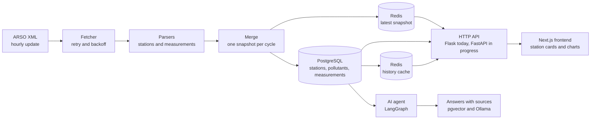

# Air Pollution Slovenia

An end-to-end platform for collecting, storing, analysing and explaining air-quality data from the Slovenian Environment Agency (ARSO).

Public ARSO XML is fetched hourly, parsed and merged, cached in Redis, stored in PostgreSQL, served through an HTTP API and displayed in a Next.js frontend. A LangGraph agent answers questions about the measurements and the underlying regulation using SQL, Redis and retrieval-augmented generation over documents.

> Slovenski povzetek: Projekt je podatkovni tok in aplikacija za prikaz ter analizo kakovosti zraka v Sloveniji. Zajema urne meritve ARSO, jih shranjuje v PostgreSQL in Redis, izpostavlja prek API-ja ter omogoča razlago z AI agentom. Dokumentacija v mapi `docs/` je v slovenščini.

## Status

Working today:

- hourly ARSO fetch with retry and backoff,
- XML parsers for stations and measurements, with per-item error isolation,
- merge of stations and measurements into one snapshot,
- PostgreSQL storage for stations, pollutants and measurements,
- Redis cache for the latest snapshot and for history payloads,
- Flask API: `/api/latest`, `/api/history`, `/api/status`,
- Next.js frontend: station cards, current values and a history chart,
- AI agent module: LangGraph, SQL and Redis tools, RAG over documents, local Ollama models,
- 51 automated tests passing.

In progress:

- async FastAPI migration (`/api/latest`, `/api/history`, `/health`),
- TimescaleDB hypertable for the `measurements` table and `timestamptz`,
- Alembic migrations and a reproducible database baseline,
- frontend map and chat interface.

Planned:

- AI answer evaluation (30–50 question set, correctness and citations),
- scheduler inside the FastAPI lifespan,
- HTTPS and a public domain,
- optional own sensor network as a separate pilot.

## Architecture



## Data flow

1. The scheduler triggers an update every hour.
2. The ARSO XML document is downloaded with retry and backoff; transient network errors do not abort the cycle.
3. Station metadata and measurements are parsed independently. A malformed station or value is skipped and logged; the rest of the batch continues.
4. Stations and measurements are merged per ARSO station code.
5. The merged snapshot is written to Redis for fast reads by the latest endpoint.
6. Unless cache-only mode is enabled, the snapshot is written to PostgreSQL. Inserts are idempotent through a unique constraint on `(station_id, pollutant_id, measured_at)`, and each batch runs in one transaction with a savepoint per tuple.
7. After a successful insert, history payloads for day, week, month and year are rebuilt and cached.
8. The API reads Redis first and falls back to PostgreSQL when the cache is empty or unavailable.
9. The frontend reads the API and renders current values, AQI colours and history charts.
10. The AI agent routes a question to SQL, Redis or document search and returns an answer with references.

## Project structure

```text
air_pollution_app/
├── backend/
│   ├── app.py                  Flask app factory, scheduler, /api/status
│   ├── main.py                 FastAPI entry point
│   ├── database/
│   │   ├── db_models.py        SQLAlchemy models: stations, pollutants, measurements
│   │   ├── session.py          sync engine and session (Flask)
│   │   └── async_session.py    async engine and session (FastAPI)
│   ├── data/
│   │   └── update_data.py      one hourly update cycle
│   ├── network/
│   │   ├── arso_client.py      HTTP fetch with retry
│   │   └── config.py           source URLs and network settings
│   ├── parsers/
│   │   ├── station_parser.py
│   │   ├── measurments_parser.py
│   │   ├── stations_and_measurments_merger.py
│   │   ├── insert_data.py      transactional insert with savepoints
│   │   └── models/             parsed dataclasses and ParseResult contract
│   ├── routes/
│   │   ├── api_latest.py       Flask endpoints
│   │   └── api_latest_fastapi.py  async FastAPI endpoints
│   ├── utils/
│   │   ├── history_cache.py    cache build and refresh
│   │   ├── history_payload.py  query, pivot and payload shape
│   │   ├── redis_client.py     Redis connection helper
│   │   └── serialization.py
│   ├── analytics/              aggregation, AQI, time utilities
│   ├── schemas/                converters and Pydantic models
│   └── tests/                  backend test suite
├── ai/
│   ├── agent.py                agent entry point
│   ├── graph.py                LangGraph wiring
│   ├── nodes/                  router, SQL, Redis, RAG and answer nodes
│   ├── rag/                    chunking, vectorisation, watcher, status
│   ├── tools.py                SQL, RAG and Redis tools
│   └── rag_sources/            source documents, including the regulation
├── frontend-next/              Next.js frontend
│   └── app/
│       ├── page.tsx            dashboard
│       ├── components/         StationCard, HistoryChart
│       └── utils/aqi.ts        AQI calculation and thresholds
├── docker/                     Dockerfile, compose, nginx configuration
├── docs/                       architecture, plans, diary, thesis documents
├── tests/                      legacy and cross-cutting tests
├── pyproject.toml              Python dependencies and pytest configuration
└── run_debug.py                FastAPI debug entry point
```

## Technology

- Python 3.12, Flask, FastAPI, SQLAlchemy 2 (sync and async)
- PostgreSQL 17 with pgvector, Redis
- APScheduler, requests, ElementTree
- LangGraph, LangChain, Ollama, pgvector
- Next.js and React, TypeScript
- Docker, Nginx, Prometheus and Grafana

## Getting started

Requirements: Python 3.12+, PostgreSQL, Redis. The AI agent additionally needs Ollama and a local model.

```bash
# 1. dependencies
uv sync

# 2. configuration
cp .env.example .env
# fill in DB_USER, DB_PASSWORD, DB_HOST, DB_PORT, DB_NAME and REDIS_URL

# 3. tests
.venv/bin/python -m pytest -q

# 4. Flask API (the current production app)
.venv/bin/python -m backend.app

# 5. FastAPI (the migration target)
uvicorn backend.main:app --reload --port 8000

# 6. frontend
cd frontend-next
npm install
npm run dev
```

## API

Flask, currently deployed:

- `GET /api/latest` — latest measurements for all stations.
- `GET /api/history?period=day|week|month|year&station_id=E403` — history payload, optionally for one station.
- `GET /api/status` — simple liveness response.

FastAPI, implemented in code and not yet the production entry point:

- `GET /health`
- `GET /api/latest`
- `GET /api/history`
- `GET /docs` — interactive OpenAPI documentation when running the FastAPI app directly.

## Database

Current tables:

- `stations` — station metadata, ARSO code, coordinates and elevation.
- `pollutants` — pollutant names and units.
- `measurements` — one row per station, pollutant and hour, with a unique constraint that makes re-runs idempotent.
- `documents` — LangChain/pgvector table for RAG sources; not managed by the application models.

Planned migration:

- TimescaleDB applies **only to the `measurements` table**, which becomes a hypertable partitioned by `measured_at`. Stations, pollutants and documents remain ordinary PostgreSQL tables.
- `measured_at` moves from `timestamp` to `timestamptz`; values are stored in UTC and converted only for display.
- The primary key changes so that every unique index includes `measured_at`, as TimescaleDB requires.
- Alembic will provide a baseline and versioned migrations; the AI `documents` table and foreign schemas are excluded from autogenerate.

## AI agent

The agent combines three sources:

- SQL queries over the measurements database,
- cached latest and history payloads in Redis,
- retrieval over documents in `ai/rag_sources/` (regulation, limit values, ARSO reports).

Answers are built from retrieved sources and returned with references. The evaluation set and the scoring of answer correctness are still to be completed.

## Testing

```bash
.venv/bin/python -m pytest -q
```

Current result: 51 passed. The suite covers the ARSO client, both parsers, the merge step, transactional inserts, update orchestration, cache and history payloads, the Flask API and the async history fallback.

## Deployment

The application runs on a Hetzner server with Docker Compose:

- Nginx serves the static frontend and proxies `/api/` to the backend container.
- The backend runs under Gunicorn (`backend.app:app`).
- PostgreSQL and Redis are bound to localhost and reached through an SSH tunnel for administration.
- Prometheus and Grafana provide monitoring.

Known infrastructure issues to fix: the Docker build expects `requirements.txt`, which does not exist (the project uses `pyproject.toml` and `uv.lock`), and the GHCR workflow references a `docker/Dockerfile.api` that is not present.

## Documentation

- `docs/razvoj/tok_podatkov.md` — detailed data flow and decisions.
- `docs/načrti/` — migration plans and work plan.
- `docs/diploma/dispozicija.md` — thesis disposition.
- `docs/arhitektura/archflow/architecture-report.html` — generated architecture report.
- `docs/dnevnik dela/` — daily work log.

## Data and attribution

Measurement data is published by the Slovenian Environment Agency (ARSO). Regulatory documents in `ai/rag_sources/` include the regulation on emissions into air from stationary sources. Data is used with attribution to the source.

## Security

- `.env` is ignored and must never be committed.
- Credentials that appear in older git history must be rotated; the repository history is not a secret store.
- The public API has no authentication and is intended as a demonstration; do not expose administrative endpoints.
